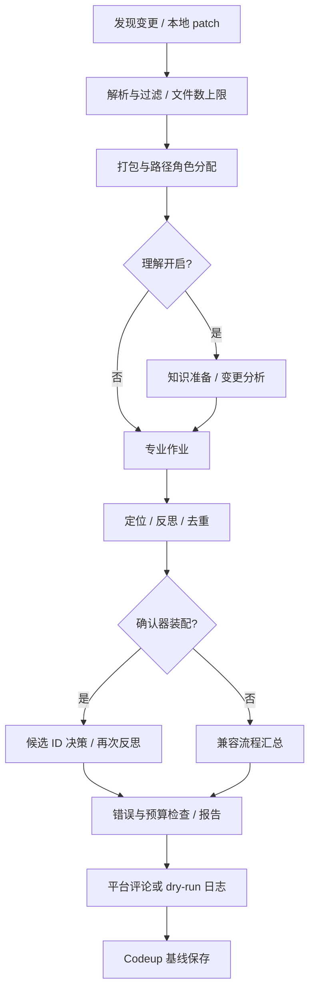

# AI 审查关键设计与实现边界

> 维护日期：2026-10-13。依据 HEAD ca57fa55 加核对时的未提交工作区，不代表仅该提交的能力。本文描述当前设计及限制，不授权执行其中的部署、发布或修复步骤。

入口：[项目总览](../GO_AI_PR_Review.md)；模块定位：[技术框架](../技术框架层级说明.md)；操作与验证：[部署与验收](deployment-and-acceptance.md)。

## 1. 目标、职责与证据层级

目标是针对明确版本的变更生成有代码依据、覆盖边界可识别的审查报告。审查服务不自动修改业务代码，也不执行业务编译/测试、合并或部署。知识文档用于背景，diff 用于变更证据，两者不能互相替代。

| 层级 | 证明什么 | 不证明什么 |
|---|---|---|
| 静态源码核对 | 某路径存在及其当前分支行为 | 实际权限、供应商兼容或线上成功 |
| 本地测试/Mock | 指定输入和异常路径符合测试断言 | 模型质量、真实平台完整契约 |
| 实际平台试点 | 指定账号、仓库和时点的读写结果 | 所有仓库、所有版本或长期可用性 |
| 专家验收 | 给定样本上的问题真实性与使用效果 | 未标注代码不存在缺陷 |

当前全量测试有一项来源隔离失败；相关能力不能标记为已验收。本次不对供应商价格、模型上下文上限或线上分支 HEAD 作外部事实判断。

## 2. 审查流水线与信息边界



knowledge、analyzer、confirmer 随 understanding.enabled 一起装配。知识参与变更分析；专业角色和确认器主要读取 ChangeContext 摘要及 diff，不是各自读取全仓源码。知识准备在打包后、专业作业前发生；图中打包和角色分配是确定性准备，不代表角色已经调用模型。

作业是“包×实际分配且启用的角色”。角色是专业视角，不是单独训练的模型。按 Priority 分批，批内受 semaphore 并发限制；多个包中的同一角色可能一部分成功、一部分失败。

## 3. 版本一致性

### 3.1 Codeup MR

捕获源 CommitID、PatchSetBizID 与目标 SHA，用 SHA 而非可移动分支名获取 compare diff。目标优先从 MERGE_TARGET 版本读取，缺少时查询目标分支 HEAD。审查后重新读取版本与目标 SHA，任一变化即放弃发布及基线推进。

该设计避免主要的版本/diff 错配，但复查与评论请求不是平台原子操作，之后仍可能推送；用 MR 源版本 ID 发布不能保证平台当前页面正好显示被审版本。真实 Codeup 的 compare/版本/评论契约需要专门验收。

GitHub 当前按 PR HEAD SHA 评论标记去重；没有把 Codeup 的审查后版本复查保障自动推广到 GitHub。代码位置应回到各自平台流程核对。

### 3.2 知识与业务文档

知识的 SOURCE-SHA 表示来源版本；文档维护日期不改变它。审查 diff SHA 与知识 SHA 不必相同：知识可能来自 main，而变更来自功能分支。报告和人工复核必须识别两者的用途。

**当前缺陷**：Prepare 会读取 SOURCE-SHA，但没有可靠拒绝不同 SOURCE-REPOSITORY 的知识。相同 SHA 会直接复用错误仓库文档；已有测试复现。strict=true 只阻断返回的准备错误，无法拦截该 nil 错误路径。修复前必须独立配置文档路径并人工核对来源，不能把该操作规避写成代码保障。

## 4. 知识初始化、更新与降级

| 情况 | 当前行为 | 使用限制 |
|---|---|---|
| 已有文档 SHA 等于来源 HEAD | 复用文档，不更新模型知识 | 仍受来源校验缺陷影响 |
| 已有旧 SHA，HEAD 变化 | 获取增量 diff，模型更新，写成功后返回新快照 | 超出文档 60000/增量 90000 字节预算报错，保留旧版本 |
| 无旧 SHA | 读取 snapshot_repository 的指定 Git commit 文本源码快照 | 需要本地 Git 与完整对象，seed 不能单独作为初始化依据 |
| 准备失败，strict=true | 阻断当前审查 | 不发布，不推进当前审查基线 |
| 准备失败，strict=false | 使用返回的带旧 SHA 快照；没有可用旧快照则空知识继续 | 必须阅读降级说明，旧知识不是最新 HEAD |
| 读取本地文档失败 | 返回空快照和错误 | 不能保证总有兜底 |

首次快照只读取 Git 已提交 blob，不读取工作区未提交文件。按扩展名选择 Go/C++、proto、YAML、构建等文本，排除 vendor、third_party、符号链接和二进制；范围由 internal/understanding/snapshot.go 定义。每个文件附 SHA256，记录 commit 和文件数量。max_snapshot_bytes 默认 1000000，超限失败，不把不完整快照标记为最新知识。

这仍是选择性证据初始化：没有包含所有文件，也没有证明模型读懂全部内容。巨大快照还可能超过供应商上下文或轮次预算，需在运行前评估；不能仅提高字节上限就宣称解决理解质量。

文档使用同目录临时文件替换。CLI 获取路径锁，Manager 内部串行；没有 fsync 或跨服务事务承诺。docs 挂载可写时模型更新会覆盖本地知识，应保留试点副本并按版本管理。

## 5. 候选问题与最终确认协议

先做文件/新文件 hunk 定位，再按配置做引用检查、建议片段验证和去重。定位允许 3 行边界吸附或降级 line=0；它不是语义证明。引用检查跨 diff，不能证明引用属于问题文件。.go 建议使用 Go parser，其他语言不校验。

确认输入使用最多 80000 字节 diff；超限时退到完整文件边界，避免用截断 hunk 验证位置。按严重度排序，从可见文件中选择最多 40 个唯一候选；非负行号必须在可见 hunk 中，line=0 允许文件级候选。

候选 ID = SHA256(原 Issue JSON)。模型不能返回新的 Issue，只能输出：

```json
{"overview":"确认总览","decisions":[{"candidate_id":"输入中的实际 ID","confirmed":true,"reason":"基于证据的判断理由"}]}
```

程序拒绝未知字段、未知或重复 ID、缺少 confirmed、空 reason 及非法 JSON。确认使用原 Issue 的位置、问题、证据和建议，只改角色归属；之后重跑已启用反思器，不再重跑定位。

| 情况 | 处理 |
|---|---|
| 无候选 | 不调用确认模型 |
| 有候选但无完整可见证据 | 确认报错，阻断发布 |
| 明确 confirmed=false | 计入驳回 |
| 超候选预算、文本不可见、重复候选或遗漏决定 | 计入未确认，不等于驳回 |
| 响应有决定但 ID/协议错误 | 整体确认失败，阻断发布 |

提示要求所有输入 ID 返回一次，但代码允许遗漏并披露；decisions=[] 在有合法输入时也可能形成全部未确认报告。UnconfirmedCount 按原候选数减已决策唯一 ID 数计算，包含输入重复项，不是漏报率。reason 当前只做协议校验，没有逐项保存在最终报告。确认后反思可能再过滤，确认总览的数量与最终展示数应分别理解。

## 6. 覆盖、作业与零问题解释

max_files_per_review 超限直接报错，不抽样通过。max_diff_chars 按 UTF-8 安全字节边界截断分析/单包输入，可能切开 hunk。报告分别披露纳入文件数、分析字节、截断包、确认字节和未确认数，这些指标不是模型实际阅读或理解率。

作业统计为成功/失败数；角色统计为全部成功、部分失败、全部失败。路径没有分配的角色不算运行失败。零作业和全部作业失败均阻断；部分失败仍可出报告。

零问题且有截断、未确认、失败作业或分析截断时，报告显示“审查不完整”。其他零问题报告当前会显示“通过”，只能解读为本次执行范围未发现明显问题；strict=false 的旧知识降级并不必然触发这个不完整判定，必须同时阅读验证总览。关闭理解模块仍保留固定章节标题，不代表执行了理解/确认。

## 7. 轮次预算与取消

RunOnce 的所有仓库共享预算，ReviewLocalDiff 独立建立预算。知识更新、分析、专业调用、确认和 HTTP 重试都在同一上下文中计入。

| 配置 | 缺省行为 | 含义 |
|---|---|---|
| review.max_llm_calls | 100 | HTTP 尝试数上限，包括重试 |
| review.max_round_tokens | 1000000 | 估算预留量上限，不是实际 tokenizer |
| review.round_timeout | 20m | 一轮超时，触发取消 |
| review.max_round_cost | 0 | 关闭费用预算；正数需 llm.prices |
| llm.prices | 无统一默认价格 | 每百万输入/输出单价，统一币种 |

每次 HTTP 尝试前按消息 JSON 字节数+256 估算输入，加 max_tokens 预留输出；费用按配置价格估算。失败不退款，因为网络错误不能证明未计费。并发预留加锁，超限取消共享 context；reviewDiff 在发布前检查错误。已完成的其他仓库评论和知识写入不会回滚。

该机制限制本地调度与估算费用，不保证供应商真实收费硬上限，也不是实际 Usage 的完整账本。模型 response Usage、预留量与供应商账单应分别记录，货币与价格来源由部署者核实。

## 8. 状态、发布与单机锁

| 阶段/结果 | Codeup 基线 |
|---|---|
| 初次发现，review_first_push=false | 仅保存 HEAD，不调用变更审查 |
| 筛选后无文件 | 保存当前版本，不代表语义审查完成 |
| 审查失败、预算取消或 MR 版本变化 | 不推进该审查版本 |
| 正常 dry-run 或评论开关关闭 | 仍保存版本；下轮可能跳过 |
| 评论发布失败 | 不推进 |
| 评论成功、保存失败 | Store 内存回滚；平台评论已存在，可能重复发布 |

Store.Set 写失败恢复原内存；保存成功后才保留新内存状态。远端评论与本地文件仍不是事务，没有恰好一次保证。不能通过手工推进基线来掩盖发布失败，应先核对远端评论与对应 SHA。

CLI 对 Codeup state_path 和知识 document_path 的 .lock 文件获取操作系统锁，并在正常退出关闭；纯 GitHub 非本地模式使用 ./data/github-agent.lock。库级调用不自动锁；不同路径、工作目录、主机或不支持相同锁语义的共享卷可绕过互斥。持有锁不等于分布式租约，删除锁文件不是安全恢复方案。

## 9. 运维与后续优先级

管理端默认回环地址。POST /trigger 需要 Bearer 令牌，无令牌禁用；/health 无鉴权且只表示 HTTP 存活。非回环配置要求令牌，但 HTTP 无 TLS；暴露方式由实际部署确定。202 不代表审查成功，-once 退出 0 也不能替代日志验收。

优先修复知识仓库来源隔离；随后验证真实 MR 契约、发布/落盘故障恢复与容器初始化。逐候选理由持久化、分布式协调、精确 Token 预算等属于后续设计，不写成当前能力，也不纳入本次文档修改的代码范围。
