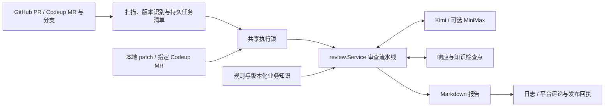

<!-- SOURCE-MODULE: gvs-pr-agent -->
<!-- SOURCE-SHA: 14eec0537a24ed10d33b7fb6d6d6cbdbc709ded1 -->

# AI_IR_REPLAY 项目理解

AI_IR_REPLAY 是一个 Go 实现的 AI 代码审查服务，Go module 与主程序名为 `gvs-pr-agent`。它从 GitHub PR、Codeup MR / 分支或本地 patch 获取变更，结合规则和可选的业务知识，组织多个专业角色审查，校验候选问题并生成 Markdown 报告；配置允许时将报告发布为平台评论。

> 维护日期：2026-10-16。源码基线：`14eec0537a24ed10d33b7fb6d6d6cbdbc709ded1`。本文按当前源码、配置和测试定义核对，采用 L0 系统关系、L1 模块职责、L2 调用链、L3 契约的粒度。它不代表真实供应商、远端评论、部署环境或缺陷检出率已经验收。

## 0. 文档范围与阅读入口

本文解释 **AI_IR_REPLAY 自身**。被审查的 GVS / infer 是独立业务仓库，其源码不链接进审查程序。业务知识分别位于 [GVS 代码理解](docs/gvs-code-understanding.md) 和 [infer 代码理解](docs/gvs-infer-code-understanding.md)，其中的 `SOURCE-SHA` 属于对应业务仓库，不能用于标识本项目版本。

| 需要了解的内容 | 文档 |
|---|---|
| 项目定位、审查思路与效果边界 | [AI 审查项目说明](GO_AI_PR_Review.md) |
| 包职责与技术细节 | [技术框架层级说明](技术框架层级说明.md) |
| 大变更、完整证据、串行执行与续审 | [大变更与单 PR 续审](docs/large-review.md) |
| 部署、持久化、升级与验收 | [部署与验收](docs/deployment-and-acceptance.md) |
| Windows / Linux 常驻进程管理 | [常驻审核一键启停](docs/persistent-control.md) |
| 规则、知识和发布设计背景 | [关键设计](docs/review-design.md) |
| 凭据注入与环境配置 | [环境说明](env.md) |

历史文档和代码注释可能描述旧实现。出现冲突时，沿本文列出的函数核对目标提交；维护日期较新也不等于所有段落均已重新验证。本文是人工维护的导航文档，不会自动成为 `understanding.document_path` 指定的运行期知识。

## 1. L0：系统上下文与运行边界

| 系统关系 | 当前实现与依据 |
|---|---|
| 程序入口 | [cmd/agent/main.go](cmd/agent/main.go) 装配配置、日志、实例锁和 `review.Service`；[go.mod](go.mod) 声明 Go 1.23，直接第三方依赖为 `gopkg.in/yaml.v3` |
| 代码平台 | [internal/github](internal/github/client.go) 使用 HTTP API 获取 PR、固定 SHA compare 和评论；[internal/codeup](internal/codeup/client.go) 获取分支、MR、版本、compare，并发布 MR / commit 评论 |
| 模型服务 | [internal/llm](internal/llm/client.go) 使用兼容 Chat Completions 的 HTTP JSON 接口；当前业务配置采用 Kimi，启用备用时降级到 MiniMax |
| 业务知识 | [internal/understanding](internal/understanding/manager.go) 跟踪配置指定的 Codeup 仓库和来源分支；首次初始化从本地 Git 对象取得固定提交的选择性源码快照 |
| 本地持久化 | JSON 基线、任务清单、模型冷却、发布回执、响应检查点和 Markdown 知识；没有数据库或外部消息队列 |
| 调度 | 定时轮询和管理接口触发，无 PR Webhook 接收器；扫描可以重叠，同一共享运行目录中的实际审查流水线串行执行 |
| 输出 | 日志 / 标准输出和平台全局评论；问题中含文件与行号，但不是平台原生逐行 review comment |
| 进程运维 | [internal/lifecycle](internal/lifecycle/lifecycle.go) 配合根目录 Bash / PowerShell 脚本管理 GVS、infer 两套配置对应的审核实例 |



“多 Agent”指同一进程内不同角色的提示词与模型调用，没有为每个角色启动独立程序。专业角色主要看到自己分配的 diff、规则和共享变更摘要；启用知识模块也不意味着每个角色都读取业务仓库全文。

## 2. L1：目录、模块职责与依赖

| 层 / 路径 | 关键符号 | 职责 |
|---|---|---|
| `cmd/agent` | `main`、`validateFocusedFlags`、`adminHandler` | CLI、配置加载、模式选择、管理 HTTP 接口 |
| `internal/config` | `Load`、`ValidateRuntime`、`Validate` | 严格 YAML 解码、环境覆盖、默认值与运行条件校验 |
| `internal/scheduler` | `Run`、`Trigger` | 启动即扫描、周期 / jitter 扫描、手动触发与取消等待 |
| `internal/review` | `NewService`、`RunOnce`、`reviewDiff` | 装配依赖，统一平台入口、任务调度、预算、缓存和发布控制 |
| `internal/github`、`internal/codeup` | `GetCompareDiff` 等 | 平台 HTTP 协议、分页、版本和评论适配 |
| `internal/diff`、`internal/filter` | `Parse`、`Files`、`MatchBranch` | unified diff 解析，新文件行范围，路径 / 分支筛选 |
| `internal/packager` | `PackBounded`、`AgentsFor` | 模块归组、按文件数及字节拆包、超大文件按完整 hunk 分片、角色分配 |
| `internal/rules`、`internal/prompt` | `NewStore`、`ForAgent`、`System`、`User` | 规则来源选择、规则热更新、专业提示词 |
| `internal/understanding` | `Manager.Prepare`、`gitSnapshot` | 来源检查、初始源码快照、业务知识增量更新 |
| `internal/analyzer` | `Analyze`、`AnalyzeBatches` | 从知识和变更形成共享意图、风险、行为约束；大输入分批归并 |
| `internal/agent` | `Agent`、`BuildEnabled`、`baseAgent.Review` | 角色工厂、模型调用、问题数组解析与严重度归一 |
| `internal/coordinator` | `Run`、`Confirmer.Confirm` | 包 × 角色作业调度、候选汇总、最终证据确认 |
| `internal/locator`、`internal/reflector` | `Locate`、`Reflect` | 文件 / 行号定位，引用启发式检查、Go 建议语法检查和去重 |
| `internal/llm` | `Chat`、`WithBudget`、`WithReviewSession`、`WithCheckpoint` | HTTP、重试、主备路由、预算、供应商冷却与响应复用 |
| `internal/state`、`internal/instance` | `Store.Set`、`Acquire` | Codeup 成功基线落盘、写失败内存回滚、操作系统文件锁 |
| `internal/notifier` | `BuildComment`、`Marker` | 报告格式、排序、覆盖信息和版本去重标记 |
| `internal/lifecycle`、`internal/logger` | `Run`、`New` | 实例启停、进程身份核对与结构化日志 |
| `configs`、`tools`、`testdata` | 配置 / 规则 YAML、`mockllm`、`sample.patch` | 部署配置、规则、离线演示与测试输入 |

依赖由入口流向 `review`，再流向平台、知识、协调器和模型客户端。业务编排集中在 `review`；角色不自行发布评论，LLM 客户端不决定成功基线，`notifier` 只组织输出。新增能力应先明确属于哪一层，避免把平台状态、模型输出和发布完成混成同一状态。

## 3. L2：核心调用链

### 3.1 启动、运行模式与退出

普通审查启动顺序：解析参数 → `config.Load` → CLI 覆盖 → `ValidateRuntime` → 日志 → 平台 / 模型必需项校验 → 获取状态 / 知识路径锁 → `review.NewService` → 信号 context → 规则热更新 → 运行模式分发。`-action` 是更早返回的独立管理分支，不加载审查配置。

| 入口 | 行为与边界 |
|---|---|
| 默认运行 | 启动管理 HTTP 服务和调度器；立即扫描，随后按周期扫描 |
| `-once` | 调用一次 `RunOnce`，其中可能只执行一个实际审核流水线；仓库错误记日志，不统一转换为非零退出码 |
| `-diff PATH` | 读取本地 patch 并打印报告；跳过平台必需项 `Validate`，仍要求运行配置有效且模型 key 非空 |
| `-repo REPOSITORY -mr ID` | 指定一个已配置 Codeup 仓库的正整数 MR，单次执行；两参数必须成对，不能与 `-diff` 混用 |
| `-dry-run` | 禁止发布评论；仍可请求平台 / 模型、写知识、缓存和成功基线 |
| `-rule PATH` | 规则来源最高优先级，具体回退行为见 L3 |
| `-checkpoint-dir PATH` | 覆盖响应检查点目录；显式传空字符串关闭此缓存，不关闭共享运行目录 |
| `-action start/stop/restart/status -instance all/gvs/gvs-infer` | 管理本项目审核实例，不允许混用普通审查参数 |

`RunOnce` 和手动指定 MR 均受 `review.active_hours` 约束；本地 diff 不经过该时间窗口。普通审查进程通过 `signal.NotifyContext` 响应取消，调度器等待已启动的扫描返回；Windows 管理停止采用进程终止，不能据此假定在途工作完成了优雅收尾。

### 3.2 扫描、排队与固定版本

[service.go](internal/review/service.go) 的 `RunOnce` 先收集 GitHub PR、Codeup MR 和分支任务，再交给 [runtime.go](internal/review/runtime.go) 的 `executeCollected`。发现阶段按入口应用 WIP、冲突和分支过滤并构造版本身份；排队时按持久任务版本去重，领取后再检查平台评论存证或成功基线。

`runtimeQueue` 在 `review.runtime_dir/tasks` 保存任务，`queue.lock` 保护清单，`execution.lock` 保护整条审核流水线。候选按上次尝试时间、创建时间和任务键排序，结合 `RetryAt` 与最近扫描时间选择；其他所有者的队首任务留给对应实例执行。每轮最多启动一次包含待审文件的 `reviewDiff`，此前可跳过多个无需审查的任务。

当前是**扫描可重叠、PR 审核串行、单 PR 内专业作业可并行**。共享目录必须解析到同机同一位置，并具有有效文件锁语义；不同路径、主机或旧版二进制没有共同互斥保障。

| 入口 | 审查身份与差异来源 |
|---|---|
| GitHub PR | 轮询过滤目标分支；源 SHA、目标 SHA、标题 / 描述和配置 / 规则依赖参与版本识别；使用固定 SHA compare，获取 diff 后及发布前复查版本、状态和元数据 |
| Codeup MR | 轮询过滤源分支，手动指定模式绕过该分支过滤；源 / 目标 SHA、MR 元数据及配置依赖参与识别；目标分支单独变化也可触发重审 |
| Codeup 分支 | 持久基线与当前 HEAD 的 compare；首次发现且 `review_first_push=false` 时只记录基线；相同 HEAD 已完成后仅改规则 / 配置不会触发分支重审 |
| 本地 diff | 标题、patch 内容及配置 / 规则依赖形成响应缓存身份，不需要远端 PR |

固定版本复查与远端发布之间仍有时间窗口，平台 API 与本地文件不是跨系统事务。

### 3.3 共享审查流水线

`reviewDiff` 的主要阶段如下；完整调用依据见 [service.go](internal/review/service.go)、[coordinator.go](internal/coordinator/coordinator.go)。

| 阶段 | 处理与失败条件 |
|---|---|
| 解析与筛选 | `diff.Parse` → `filter.Files`；剔除二进制和已删除文件，再应用 include / exclude；无文件返回空结果；筛选后文件数超过上限则失败，不抽样审查 |
| 分包 | `PackBounded` 保留完整 hunk；单个 hunk 加文件头仍超预算则失败；关闭分包后整体超预算也失败 |
| 模型选择 | 依据变更新增 / 删除行数选择 small / medium / large 档；档位是否使用不同模型取决于配置 |
| 知识准备 | `prepareKnowledge` 优先恢复该审查已固定的知识快照，否则调用 `Manager.Prepare`；记录同步、复用或降级状态 |
| 变更分析 | `Analyze` 生成 `ChangeContext`；筛选后的完整 diff 超过 `max_diff_chars` 时，`AnalyzeBatches` 逐包分析并分层归并，无法容纳或缩小则失败；此阈值不包含知识、标题、描述和 system prompt |
| 专业作业 | `Coordinator.Run` 将包与启用角色组合，按 priority 分批，同批用并发上限约束模型调用 |
| 候选处理 | 确定性排序 → 可选定位 → 可选反思 / 去重 → 可选 LLM 最终确认 → 再执行已启用的反思 |
| 完成检查 | 零作业 / 全失败、任一失败作业、截断包、未确认候选、确认错误、预算错误或取消均阻断结果发布 |
| 输出 | `notifier.BuildComment` 生成报告；平台调用方决定发布开关、回执和基线推进；本地模式打印报告 |

`understanding.enabled` 同时控制知识管理器、变更分析器和最终确认器的装配。关闭它仍运行专业角色及已启用的定位 / 反思，但没有前置知识分析和 LLM 最终确认。专业任务接收序列化 `ChangeContext`，而不是直接接收完整知识文档。

### 3.4 角色路由与规则

当前支持 11 个角色：`architect`、`security`、`performance`、`standard`、`test`、`ai`、`ui`、`ai_tool`、`concurrency`、`resource`、`dataflow`。是否运行由 `agents.<role>.enabled`、包路径与分包开关共同决定，不能把“支持 11 个角色”解释为每个文件必经全部角色。

启用分包时，[packager.go](internal/packager/packager.go) 的 `AgentsFor` 为每包分配全局角色 `security/architect/standard/concurrency/resource`，再按路径追加专项角色；GVS 的 dnn、跟踪、HTTP、数据流路径和 infer 的 models、core、service、streamer 等有专门映射。未命中模块规则的文件按顶层目录归组。关闭分包时不做这种角色路径限制。

角色的 `Priority()` 控制批次先后，较早批次完成后才启动下一批；`max_agent_concurrency` 限制批内作业并发，不限制整个 PR 的总调用数。分包、角色数量、解析重试、供应商重试及最终确认都会影响费用和耗时。

### 3.5 知识更新、恢复与发布

`Manager.Prepare` 先校验文档来源仓库和有效 SHA 标记，再查询来源分支 HEAD。版本相同则复用；已有版本且 HEAD 变化时读取 compare 增量；无可用版本时要求 `snapshot_repository` 中存在匹配的 Git commit。生成新文档后以同目录临时文件替换，成功后才返回新版本。

`prepareKnowledge` 为一次审查固定知识快照，避免续审时来源分支推进导致提示词改变。LLM 响应缓存按固定身份和实际请求匹配，消费者仍做协议校验；被拒绝的响应失效，响应 / 知识检查点落盘失败会阻断完成。缓存命中不产生新的 HTTP 调用及本次 Usage。

发布由 [publication.go](internal/review/publication.go) 的 `publishOnce` 先检查回执，远端成功后写回执，再由调用方推进 Codeup 成功基线。回执减少“评论成功、基线失败”后的重复发布，但远端成功到回执写入之间仍可故障。基线、缓存、运行任务状态和发布回执各有用途，删除缓存不等于请求重审。

## 4. L3：关键协议与不变量

### 4.1 配置与规则契约

[config.go](internal/config/config.go) 只接受单份 YAML 文档并拒绝未知字段；`${ENV_VAR}` 在读取时展开，程序本身不自动加载 `.env`。`AGENT_CONFIG_PATH` 决定默认配置路径，显式 `-config` 优先。`AGENT_REVIEW_RUNTIME_DIR`、`AGENT_SERVER_ADDR`、`AGENT_ADMIN_TOKEN`、`AGENT_LOG_LEVEL` 可覆盖对应字段，`AGENT_REVIEW_DRY_RUN=true/1` 可强制启用 dry-run。

规则按 `-rule` → `rules.project_path` → `rules.global_path` → 内嵌默认依次选择第一份可用文档，不合并四个来源。缺失文件可回退；显式 CLI 文件存在但解析失败则报错。选定文档内部再组合 `global`、`agents[role]` 和所有匹配的 `paths` 规则。热更新轮询当前文件修改时间，一次审查固定所选规则快照。

| 配置 | 程序缺省值 | GVS / infer 业务配置当前值 |
|---|---|---|
| `review.max_files_per_review` | 20 | 100 |
| `review.max_diff_chars` | 60000 字节 | 120000 字节 |
| `review.file_packaging.max_package_size` | 5 | 5 |
| `review.max_agent_concurrency` | 4 | 4 |
| `review.max_llm_calls` | 100 | 600 |
| `review.max_round_tokens` | 1000000 | 12000000 |
| `review.round_timeout` | 20m | 60m |
| `review.max_round_cost` | 0，关闭费用预算 | 0 |
| `review.runtime_dir` | `./data/review-runtime` | 两实例共享该目录 |
| `review.checkpoint_dir` | `./data/checkpoints` | 两实例使用该目录，缓存身份隔离 |

数值依据 [默认值](internal/config/config.go)、[GVS 配置](configs/config-gvs.yaml)、[infer 配置](configs/config-gvs-infer.yaml)。`max_diff_chars` 实际按 UTF-8 字节长度检查，既不是字符数也不是 tokenizer 结果。`max_package_size` 在大文件拆分后约束的是文件片段数。配置中的默认值和部署文件显式值应分别理解。

### 4.2 模型请求、降级与预算

模型客户端向 `base_url/chat/completions` POST，发送 model、messages、max_tokens、temperature，key 通过 Authorization 头传递。网络和可重试 HTTP 错误按策略重试；鉴权、供应商配额、普通请求错误分别处理，不能把所有失败都解释为限流。

业务配置的备用链路为 Kimi → MiniMax。每次 PR 审查尝试新建 `ReviewSession`；未命中响应检查点时，依据已知冷却状态选择主备，不进行远端可用性预检，该尝试一旦降级不回跳。供应商冷却持久化到共享运行目录，与响应缓存分离；冷却期间允许复用已有响应，缺少缓存且全部供应商不可用时等待后续尝试。

预算由 [budget.go](internal/review/budget.go) 定义，在 `runTask` / `executeCollected` 为**每个任务实际尝试**创建，虽然配置字段仍名为 `max_round_*`，并非所有仓库共享一次扫描预算。每次 HTTP 尝试前按消息 JSON 字节数 + 256 估算输入，再加最大输出预留；失败请求、重试和备用模型均计入，失败不退还。金额预算使用配置单价，不能视为供应商真实账单硬上限。

### 4.3 问题与最终确认协议

专业角色输出 `Issue[]`，核心字段为 `severity/file/line/problem/detail/suggestion/code`。`line` 是新文件行号，`0` 可代表文件级问题；严重度归一为 `critical/high/medium/low`。`baseAgent.Review` 最多进行两次解析尝试，兼容 JSON 围栏和部分推理文本清理；成功解析不等于问题真实。

最终确认器以原始问题内容生成 `candidate_id`，模型只返回决定，不新增或改写问题：

```json
{"overview":"确认总览","decisions":[{"candidate_id":"输入中的实际 ID","confirmed":true,"reason":"基于证据的理由"}]}
```

每批最多 40 个唯一候选，system/user 消息正文合计不超过 160000 字节，按 JSON 编码后的实际文本检查。证据优先用完整文件 diff，过大时改用候选所在完整 hunk；文件级候选需全部 hunk。同批共享证据只发送一次，单候选所需完整证据也无法容纳时失败。40 是每批上限，不是整个 PR 只确认前 40 个问题。

未知字段、未知 / 重复 ID、遗漏决定、缺少 `confirmed`、空 `reason` 或缺失证据均不被当作成功确认。依据为 [confirmer.go](internal/coordinator/confirmer.go)。确认原因用于校验，当前不逐项保存在最终报告中。

定位器检查文件与 diff 行范围，反思器做启发式引用检查、建议片段语法检查和相似问题去重；这些步骤不执行建议代码，也不能证明业务语义正确。Go 语法验证不能替代编译，其他语言也不能据此宣称已验证。

### 4.4 知识来源契约

运行期知识使用 `SOURCE-REPOSITORY` 和 `SOURCE-SHA` 标记。来源不匹配、版本化文档缺少仓库标记、多个有效 SHA 标记冲突时，管理器拒绝该文档，且不把它作为合法旧快照返回。普通更新失败时，`strict=true` 阻断；`strict=false` 可使用返回的合法旧快照，若无合法快照则以空知识降级。

首次快照只读取固定提交的 Git blob，选择源码、协议、配置和构建文本并附内容哈希，范围由 [snapshot.go](internal/understanding/snapshot.go) 的白名单定义；例如 JS、Python、JSON 和 Markdown 不在当前快照白名单中。不包含未提交工作区内容，也不是业务全仓运行验收。初始快照默认上限 1000000 字节；增量更新的已有文档 / delta 上限分别为 60000 / 90000 字节，超限保留旧版本并报错，不能把截断输入标为已同步。随附 Codeup 配置尚未填写 `snapshot_repository`，从无版本知识开始部署时必须补齐，seed 不能替代源码快照。

知识跟踪来源分支，未必与本次 PR 源 / 目标 SHA 相同；报告中的知识版本必须独立解读。GVS 与 infer 应配置不同知识文件和状态文件。旧业务知识文档中“来源仓库隔离测试目前失败”的历史表述不能直接用于当前代码；目前实现已有来源拒绝逻辑和对应测试，测试执行结果需另行记录。

### 4.5 状态、锁与发布契约

| 资源 | 用途与边界 |
|---|---|
| `codeup.state_path` | 分支 / MR 成功版本；`Store.Set` 落盘失败会回滚内存值 |
| 状态 / 知识路径的 `.lock` | CLI 生命周期内的单机互斥；库调用不会自动获得这些入口锁 |
| `runtime_dir/execution.lock`、`queue.lock` | 整体审核串行与任务清单更新互斥 |
| `runtime_dir/tasks` | 持久任务状态含 pending、reviewing、interrupted、completed、withdrawn；失败按重试时间恢复，旧尝试不得覆盖新版本 |
| `runtime_dir/models` | 跨实例供应商冷却；关闭响应缓存仍保留 |
| `runtime_dir/published` | 平台成功发布回执；损坏回执要求先核对平台，不能盲目删掉重发 |
| `checkpoint_dir` | 模型响应和固定知识快照；版本、请求、规则、配置依赖变化会影响复用 |
| `taskTracker` | 进程内任务领取与完成去重，状态含 pending/reviewing/completed/failed；与持久清单不是同一状态机 |

`dry-run`、关闭评论、首次只建基线、筛选后无文件都可能正常推进 Codeup 基线，不能等同于已发布审查报告。成功基线、知识写入和此前已发评论不会因后续任务失败而回滚。删除缓存不会清除成功基线；取消 dry-run 会改变 GitHub PR / Codeup MR 的输入签名，使相同 SHA 也可能重新审查，但同 HEAD 的 Codeup 分支仍被基线跳过。仅打开评论开关也不能保证补发，试点应隔离状态与知识。

### 4.6 管理 HTTP 契约

常驻模式默认监听 `127.0.0.1:8081`，部署配置可覆盖。`GET /health` 返回存活信息，不验证模型、平台、队列或最近审查是否成功。`POST /trigger` 需要 `Authorization: Bearer <admin token>`；未配置令牌返回 503，错误令牌返回 401，接受触发返回 202。待处理触发可以合并，202 不代表审核完成。

非回环监听必须配置令牌；服务自身没有 TLS。单次 diff、指定 MR 和 `-once` 模式不启动此管理服务。依据为 [main.go](cmd/agent/main.go) 的 `adminHandler` 与 [config.go](internal/config/config.go) 的运行校验。

## 5. 构建、演示与部署入口

从项目根目录执行，准备 Go 1.23 或兼容工具链；平台、模型和知识初始化权限按实际配置提供。以下本地 Mock 演示不需要真实 API key。

终端一启动固定响应服务：

```sh
go run ./tools/mockllm
```

终端二执行本地 diff（PowerShell 示例，使用独立演示运行目录）：

```powershell
$env:AGENT_REVIEW_RUNTIME_DIR = "./data/readme-demo/runtime"
go run ./cmd/agent -config configs/config.mock.yaml -diff testdata/sample.patch -dry-run -checkpoint-dir ./data/readme-demo/checkpoints
```

Bash 对应第二个命令：

```sh
AGENT_REVIEW_RUNTIME_DIR=./data/readme-demo/runtime go run ./cmd/agent -config configs/config.mock.yaml -diff testdata/sample.patch -dry-run -checkpoint-dir ./data/readme-demo/checkpoints
```

Mock 监听 `127.0.0.1:19090`，按角色返回预设问题和固定 Usage；Mock 配置未开启知识 / 分析 / 最终确认链路。这只能验证接线和报告处理，不用于衡量模型准确率、费用或完整知识链路。演示结束可关闭终端，避免将临时环境覆盖带入正式运行。

构建和单次审查的常用入口：

```sh
# Windows 产物；Linux 构建时去掉 .exe 后缀
go build -o bin/gvs-pr-agent.exe ./cmd/agent

# 使用已准备的配置执行一轮扫描
go run ./cmd/agent -config configs/config-gvs.yaml -once -dry-run

# 手动指定 Codeup MR；123 替换为真实 MR 编号
go run ./cmd/agent -config configs/config-gvs.yaml -repo lizheng/lzvsg/gvs -mr 123 -dry-run
```

后两条会使用业务配置并访问真实服务；dry-run 仍可能计费和推进状态。执行手动 MR 前需要停止持有相同状态 / 知识锁的定时实例，或准备隔离配置。已有真实审核进程运行时不要覆盖其二进制；正式切换流程见 [部署与验收](docs/deployment-and-acceptance.md)。

常驻入口是 `start-persistent.ps1` / `start-persistent.sh`，支持 start、stop、restart、status。它们配合 `run-persistent.*` 和 `internal/lifecycle` 工作，已有二进制不保证与当前源码一致。[Dockerfile](Dockerfile) 提供多阶段构建，[docker-compose.yml](docker-compose.yml) 挂载 configs/data/docs；首次知识初始化还需容器可见的业务 Git 对象，不能仅靠这三个挂载推断已具备初始化条件。

## 6. 验证入口与已知边界

修改代码后的基本验证入口是 `go test ./...` 和 `go vet ./...`。与本理解文档关键结论对应的测试包括：

| 契约 | 现有测试入口 |
|---|---|
| 运行参数、配置与管理鉴权 | `cmd/agent/*_test.go`、`internal/config/*_test.go` |
| 完整 hunk 与大变更处理 | `internal/packager/packager_test.go`、`internal/analyzer/batches_test.go`、`internal/review/large_review_test.go` |
| 候选 ID、完整决定与证据预算 | `internal/coordinator/confirmation_protocol_test.go`、`candidate_limits_test.go` |
| 知识来源、首次快照与失败回退 | `internal/understanding/provenance_test.go`、`snapshot_test.go`、`fallback_test.go` |
| 单机串行、续审、版本与发布 | `internal/review/runtime_test.go`、`resume_test.go`、`github_snapshot_test.go`、`publication_test.go` |
| 主备路由、配额和响应缓存 | `internal/llm/fallback_test.go`、`quota_test.go`、`checkpoint_test.go` |
| 平台进程启停 | `internal/lifecycle/lifecycle_test.go`、`tools/test-start-modes.*`、`tools/test-persistent-linux.sh` |

这里列出的是验证入口，不声明本次文档更新已重新执行全部测试。Windows 原生测试、Git Bash 验证、Linux 交叉编译、Linux 原生运行和 race 检查是不同证据，不能互相替代。

审查与运维时还应明确以下边界：

- **覆盖范围**：路径筛选、角色路由、知识版本、确认证据和字节计数各自描述不同范围；“纳入所有筛选文件”不是“理解全部仓库”。排除测试或 Markdown 会直接改变审查范围。
- **模型质量**：定位、去重、二次模型确认仍可能误报或漏报；零问题只表示本次执行范围未发现候选，不是无缺陷证明。
- **成本与恢复**：失败请求可能已计费，缓存没有自动过期清理，磁盘空间与敏感代码响应的访问权限需要纳入部署。Usage、预算预留与真实账单应分开记录。
- **持久化与发布**：文件替换和进程锁不提供数据库事务、分布式协调或“恰好一次”评论保障；锁占用应核对进程，不能删锁代替停止。
- **知识新鲜度**：`strict=false` 可降级到旧知识或空知识，必须结合验证总览判断；代码来源标记合法也不能证明文档每一句都正确。

## 7. 维护约定

源码或配置变化后，按 L0 系统关系 → L1 职责 → L2 调用链 → L3 契约检查受影响段落，再记录对应提交。文档维护日期不等于代码发布或服务升级；仅改措辞时不应把知识基线改成未经核验的新源码版本。

涉及 GVS / infer 的业务结论应更新对应知识文档并分别标注两端版本；本 README 只说明审查程序怎样消费这些知识。新增模型、入口、持久状态或发布策略时，应同时核对失败、取消、版本推进、重启恢复和缓存失效路径，不把设计计划写成已实现能力。
