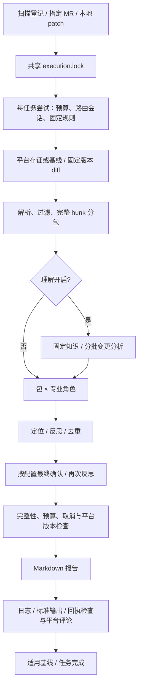

# gvs-pr-agent 技术框架层级说明

> 维护日期：2026-10-26。源码核对范围：`fd13ba6be450ba75f91ed2c795961e1b4f54f145` 及当前工作区的运行状态、理解增量更新和 Codeup MR 增量审核实现。本文说明接口、调用关系和失败契约，不据此判断运行二进制已更新或真实平台已验收。

本文面向开发、测试与运维定位。先读 [README](readme.md) 选择运行入口，再用本文追踪实现；完整业务流程图见 [项目说明第 3 章](GO_AI_PR_Review.md#3-整体架构与数据流)。[大变更与续审](docs/large-review.md)、[部署与验收](docs/deployment-and-acceptance.md)、[常驻启停](docs/persistent-control.md) 提供专题说明。历史设计文档可能保留旧实现，冲突时按本文列出的源码和目标版本核对。

## 1. 入口、运行模式与配置

### 1.1 启动与退出顺序

[cmd/agent/main.go](cmd/agent/main.go) 的普通启动顺序为：参数解析与互斥检查 → `config.Load` → CLI 覆盖 → `ValidateRuntime` → 日志 → 平台/模型必需项检查 → 状态和知识资源锁 → `review.NewService` → 信号 context 与规则热更新 → 模式分发。实例管理 `-action` 分支提前返回，不加载审查配置或调用模型。

| 参数或入口 | 行为与限制 |
|---|---|
| `-config PATH` | 显式配置优先；未传时取 `AGENT_CONFIG_PATH`，再回退 `configs/config.yaml` |
| `-diff PATH` | 读取本地 patch，调用 `ReviewLocalDiff` 并打印报告；跳过平台必需项 `Validate`，仍需有效运行配置和非空模型 key；理解开启时仍可能访问 Codeup |
| `-repo PATH -mr ID` | 指定配置内一个 Codeup MR，编号为正整数；两参数成对，不与 `-diff` 混用；模式优先于 `-once` |
| `-once` | 调用一轮 `RunOnce` 后退出；最多启动一个实际审核流水线，不承诺清空所有候选 |
| 默认常驻 | 启动管理 HTTP；启动立即扫描，之后按 `interval` / `jitter` 扫描 |
| `-dry-run` | 只强制开启禁止评论，不关闭外部请求、计费、知识更新、缓存或成功基线 |
| `-rule PATH` | 规则选择最高优先级；不是追加规则文件 |
| `-checkpoint-dir PATH` | 覆盖响应与固定知识目录；显式空字符串关闭这部分复用，共享执行锁、任务与冷却仍生效 |
| `-action start/stop/restart/status -instance all/gvs/gvs-infer` | 独立管理分支；不能混用其他审查参数；管理二进制应放在本项目 `bin` 目录 |

`RunOnce` 和指定 MR 均检查 `review.active_hours`；本地 diff 不检查。时间窗口起点包含、终点不包含，支持跨午夜；GVS/infer 随附配置的起止时间为空，当前不限制时段。

本地 diff 和指定 MR 错误会使 CLI 非零退出；`RunOnce` 返回类型没有 error，仓库与队列错误记日志，所以 `-once` 退出 0 不能证明审核成功。普通进程接收中断/终止信号并取消 context，调度器等待已启动轮次返回；Windows 管理停止采用进程终止，在途工作可能直接中断。

### 1.2 配置加载边界

[internal/config/config.go](internal/config/config.go) 读取单份 YAML，展开 `${ENV_VAR}`，应用环境覆盖，校验后填默认值，再校验。未知字段与多份 YAML 文档被拒绝；程序不自动读取 `.env`，未设置的占位变量展开为空。

`AGENT_REVIEW_RUNTIME_DIR`、`AGENT_LOG_LEVEL`、`AGENT_ADMIN_TOKEN`、`AGENT_SERVER_ADDR` 覆盖对应配置；`AGENT_REVIEW_DRY_RUN=true/1` 只会强制开启 dry-run。CLI 的 `-dry-run` 也不提供强制关闭配置中 dry-run 的功能。配置校验检查值域与依赖条件，不验证模型存在、凭据权限、网络、Git 对象或磁盘容量。

相对路径取决于进程工作目录，裸 CLI 应从项目根目录执行。跨工作目录启动时，应为共享运行目录和各实例状态/知识路径配置明确的绝对路径。

## 2. 包职责、核心接口与依赖

| 层/包 | 核心符号或文件 | 责任与边界 |
|---|---|---|
| 入口与运维 | `cmd/agent/main.go`、`internal/lifecycle` | 模式分发、管理接口、守护与审核进程身份核对 |
| 配置与日志 | `config.Load`、`ValidateRuntime`、`logger.New` | 配置和默认值、json/text/gvs 日志；日志可能包含完整报告 |
| 发现与编排 | `review.Service`、`RunOnce`、`runTask`、`executeCollected` | 收集候选、共享执行槽、每任务预算、完成判定及输出控制 |
| 平台适配 | `github.Client`、`codeup.Client` | HTTP、版本和 compare、全局评论；不判断模型结论是否正确 |
| 材料准备 | `diff.Parse`、`filter.Files`、`packager.PackBounded` | 解析、筛选、完整 hunk 分包及路径角色路由 |
| 规则与提示词 | `rules.Store`、`ForAgent`、`prompt.System/User` | 规则来源与热更新、组合任务输入 |
| 知识与分析 | `understanding.Manager.Prepare`、`analyzer.AnalyzeBatches` | 来源检查、知识初始化/增量维护、共享变更摘要 |
| 专业作业 | `agent.Agent.Review`、`BuildEnabled` | 11 类角色创建、请求与问题数组解析 |
| 调度与确认 | `coordinator.Run`、`Confirmer.Confirm` | 包×角色调度、定位/反思、候选 ID 与证据确认 |
| 本地校验 | `locator.Locate`、`reflector.Reflect` | 路径行号约束、引用启发式、Go 建议语法和候选合并 |
| 模型控制 | `llm.Chat`、`WithBudget`、`WithReviewSession`、`WithCheckpoint` | HTTP、重试、主备路由、配额冷却、响应复用 |
| 持久化与锁 | `state.Store`、`instance.Acquire`、`review/runtime.go` | Codeup 基线、任务清单、OS 文件锁及恢复 |
| 报告与发布 | `notifier.BuildComment`、`publishOnce` | Markdown、版本标记和回执；平台入口控制是否发布与基线推进 |
| 周期触发 | `scheduler.Run/Trigger` | 启动即扫描、定时/jitter、手动触发合并与取消等待 |

依赖由入口进入 `review`，再到平台、知识、协调器及模型；角色不发布评论，模型客户端不推进平台成功基线，报告生成器不领取任务。GVS/infer 是外部业务仓库，源码不链接进本 Go 二进制；“多 Agent”指同进程内不同角色的模型作业。

开发时可用以下源码路径继续定位：

| 需要改变的行为 | 优先核对 |
|---|---|
| 发现范围与平台版本 | `internal/review/service.go`、`github_snapshot.go`、平台 client |
| 排队、重试、公平顺序 | `internal/review/runtime.go`；手动/本地入口还使用 `tasks.go` |
| 输入身份和恢复命中 | `internal/review/checkpoints.go`、`internal/llm/checkpoint.go` |
| 单次调用与主备 | `internal/llm/client.go`、`session.go`、`quota.go`、`budget.go` |
| 报告内容或发布重复 | `internal/notifier/notifier.go`、`internal/review/publication.go` |

## 3. 共享审查流水线



`reviewDiff` 只处理共享审核阶段，平台发现、成功身份、版本复查及发布由调用方负责。`(nil, nil)` 表示没有待审文件，Codeup 轮询调用方可能记录基线；指定 MR 的原始差异为空时也可在版本复查后推进基线，不调用模型或发布报告。原始差异非空但筛选后无有效文件的指定 MR，以及无有效文件的本地 diff，仍报错。

`understanding.enabled` 同时装配知识管理器、分析器和最终确认器。关闭时仍可运行专业角色及定位/反思。专业角色收到序列化 `ChangeContext`、本包 diff 和规则；确认器收到摘要、候选及相关 diff 证据。启用知识不代表各角色看到全部知识正文或完整业务仓库。

Service 在返回可发布结果前拒绝零作业、全部失败、任一失败作业、截断包、未确认候选、确认错误、预算耗尽和取消。`审查完成` 日志位于这些最终拦截之前，不能作为业务成功标志。

## 4. 打包与专业作业调度

### 4.1 输入范围与完整 hunk

`filter.Files` 先去掉二进制和删除文件，再执行 include/exclude；exclude 优先，include 为空表示不额外限制。`**` 可跨目录，末尾 `/` 支持目录前缀。只剩删除文件的变更不会接受这条专业审查流程，需人工或其他检查覆盖。

`PackBounded` 先按内置 GVS 模块组归并，未命中按顶层目录回退，然后同时限制文件片段数和 diff 字节数。大文件按完整 hunk 拆分，保留文件头、路径和新文件行号范围。单个 hunk 连同头部也无法容纳时返回错误；关闭分包后整体超预算也失败。底层 `DiffText(max)` 仍有截断工具能力，但当前 Service 正常路径先检查预算，不把截断材料当作完成审查。

文件数不设上限（max_files_per_review 已移除，允许审核大 MR）；`max_package_size` 在拆分后约束片段数。`max_diff_chars` 按 UTF-8 字节检查，不是字符数或 Token，且不包括所有 system prompt、规则和知识材料。

### 4.2 角色路由、优先级与并发

支持角色为 `architect/security/performance/standard/test/ai/ui/ai_tool/concurrency/resource/dataflow`。启用分包时，全局角色为 `security/architect/standard/concurrency/resource`；其他角色由 `packager.go` 路径表追加，最终只运行配置启用者。关闭分包时全部启用角色参加单一包。

GVS 的推理、跟踪、HTTP 和流处理，infer 的 `src/models`、`src/core`、`src/service`、streamer 和测试路径有专项映射。路由粒度是整个包：包内任一文件命中角色，该角色就读取本包材料，不是逐文件单独分配。

`Coordinator.Run` 按较小 priority 先执行，同批用 semaphore 限制包×角色作业并发；前一批结束后再启动下一批。默认 `max_agent_concurrency=4`，GVS/infer 当前配置为 2（供应商账号级并发上限，403 concurrent limit 自动退避重试）。相同角色跨多个包的成功/失败分别统计，不能用“角色启动过”代替全部作业成功。增加角色、分片和解析重试都会增加调用量。

## 5. 规则选择与提示词

规则按 CLI `-rule` → `rules.project_path` → `rules.global_path` → 内嵌默认选择第一份可用文档，不合并四个来源。默认全局位置为用户目录 `.ai-review/review-rules.yaml`。缺失文件可回退；显式 CLI 文件存在但解析失败会报错，其他层解析失败可降级。

选定文档内部，`ForAgent` 合并 `global`、`agents[role]` 和所有匹配的 `paths` 规则，不在第一条路径命中时停止。热更新轮询当前生效文件修改时间，不是所有候选目录监听。一次实际尝试固定规则；规则变化参与后续身份识别，但已完成分支仍首先按 HEAD 去重。

规则是检查线索，不是缺陷证明；修改规则不会自动执行构建或测试，也不意味着已完成版本必然重审。

## 6. 模型调用、解析与预算

### 6.1 请求与主备路由

`Chat` 向 `base_url/chat/completions` POST `model/messages/temperature`（`max_tokens>0` 时附带；0 表示不限制输出，请求不携带该参数），使用 Bearer key；`provider` 不是多协议适配器。small/medium/large 按变更新增+删除行数选择，默认阈值 500/3000，GVS/infer 三档当前指向同一主模型。

业务配置采用 Kimi → MiniMax，每个任务实际尝试新建路由会话。先匹配响应缓存，命中直接返回；否则查已知冷却，再预留预算并请求。主模型未知状态由实际请求验证，没有额外收费探针。一次尝试降级后不回跳，已发出的并发请求不会撤回；下次尝试重新优先主模型并遵守共享冷却。

| 失败类型 | 当前处理 |
|---|---|
| HTTP 429 或有配额证据的 403 | 分类配额，记录供应商/端点/账号摘要对应冷却，优先采用有效 `Retry-After` |
| 普通鉴权、权限或结构化无效参数错误 | 不统一解释为配额，不保证切到备用 |
| 网络和可重试 5xx | 按 `llm.retry` 有限退避；耗尽后可降级 |
| 供应商并发上限 403（无额度证据） | 瞬态拥挤，按可重试错误退避重试，不记配额冷却 |
| 输出截断（finish_reason=length）或空内容 | 按明确可重试错误处理，不再把不完整内容交给下游解析 |
| 两模型均冷却 | 仍允许重放成功响应；缺少结果时中断，任务按重试时间恢复 |
| 冷却持久化失败 | 返回错误，不宣告任务成功 |

无有效平台恢复时间时，429 缺省复查一分钟，有额度证据的 403 缺省复查五小时；这是客户端策略，不是供应商恢复承诺。相关实现为 `client.go`、`quota.go`、`session.go`、`checkpoint.go`。

### 6.2 预算作用域与解析重试

`review.roundContext` 由 `runTask/executeCollected` 为**每个任务的一次执行尝试**创建；并非 RunOnce 全部仓库共享预算。知识更新、分析/归并、专业作业、确认、HTTP 重试和主备请求共用它，续审建立新预算。

| 字段 | 程序缺省 | GVS/infer 显式值 |
|---|---|---|
| `max_llm_calls` | 100 | 3000 |
| `max_round_tokens` | 1000000 | 60000000 |
| `round_timeout` | 20m | 240m |
| `max_round_cost` | 0，关闭 | 0，关闭 |
| `max_diff_chars` | 60000 字节 | 120000 字节 |

每次 HTTP 尝试前按消息 JSON 字节数+256 估算输入，`max_tokens>0` 时再加输出预留（0 不预留）；失败请求不退还，缓存命中不再预留且本次 Usage 记零。金额预算要求主备模型价格统一币种，属于估算，不能视作实际账单硬上限。扫描网络耗时不等同于该任务模型尝试预算。

`baseAgent.Review` 解析 `Issue[]`，兼容围栏等输出形式，解析失败最多两次尝试，且独立于 HTTP 重试。问题包括 `severity/file/line/problem/detail/suggestion/code`；严重度归一为 critical/high/medium/low。模型 Usage 来自响应，Mock 是固定数字。

## 7. 知识维护、变更分析与检查点

### 7.1 来源、初始化与更新

`Manager.Prepare` 先核对 `SOURCE-REPOSITORY` 与 SHA 标记，再查询配置来源分支 HEAD。同版本复用；版本变化获取 compare 增量，由 `incremental.go` 分批提交证据及相关旧知识，模型返回精确替换/追加补丁。全部批次在内存中应用成功后，使用同目录临时文件替换并推进 SHA；不再每次生成完整知识文档。

不同来源仓库、版本化文档缺少来源、冲突 SHA 标记均拒绝复用，也不会将错误来源作为降级快照。这里是来源一致性校验，不证明知识文本语义正确。2026-10-13 的仓库隔离失败属于历史记录，当前检查应以 `provenance_test.go`、`fallback_test.go` 和本次测试结果为准。

首次初始化要求 `snapshot_repository` 内存在来源 HEAD 对应的完整 Git commit 对象。快照读取已提交的选择性文本 blob，不读取工作区未提交内容，排除 vendor/third_party、符号链接和二进制，并附文件哈希。`max_snapshot_bytes` 缺省为 1000000，超限拒绝初始化；seed 是补充材料，不能替代源码证据。

增量维护不再以旧文档 60000 字节或累计增量 90000 字节为硬限制。每批原始证据最多 12000 字节，JSON 编码后最多 24000 字节，按 UTF-8 安全边界拆分并保留文件/hunk 上下文；相关旧知识编码后最多 24000 字节，按路径和符号匹配选择。未选中的旧知识在本地保留；替换必须命中已发送文本且在全文唯一，禁止模型修改来源标记。无效补丁或任一批失败均保留旧文档和 SHA，已返回 usage 仍统计；检查点可复用相同请求的成功批次。大 diff 仍受调用数、Token 预算及超时限制，启发式片段选择不保证召回全部跨模块关系。

`strict=true` 阻断准备错误；非严格模式可使用可信旧版本，无可信快照则可能空知识继续。首次初始化仍使用版本化源码快照及其预算检查。应阅读报告知识状态，不能把降级当成最新知识。

### 7.2 分批分析与恢复身份

`Analyzer.Analyze` 结合知识、仓库、标题、说明和 diff 生成 `ChangeContext`。完整 diff 超过分析预算时，`AnalyzeBatches` 逐包分析后分层归并；摘要无法容纳或无法继续缩小时失败，不截取前部后称为完整分析。

`review/checkpoints.go` 为本次审核固定知识，包括非严格模式实际使用的降级快照。恢复优先用已固定材料，因此来源 main 后续推进不必改变续审输入；报告中知识版本可能落后于最新分支。

外层缓存身份含任务/版本和规则、理解、角色、Review、LLM 配置摘要；内层请求键含实际消息、模型、端点、生成参数和主备凭据摘要。当前整个 Review 配置参与摘要，调整目录、预算或 dry-run 也可能改变缓存命中，不能认为只换路径仍必然复用。响应保存正文、校验摘要及原始 Usage，不另存原始提示词或明文 key；正文仍可能包含源码。

损坏/不匹配响应不重放，消费者拒绝解析或协议时使其失效；响应或固定知识保存失败阻断完成。恢复重新走编排与版本检查，没有 goroutine 或任意指令位置的执行快照。缓存没有自动清理机制。

## 8. 定位、反思与最终确认

Locator 依次做精确路径、去掉 `./`/`a/`/`b/` 后匹配及唯一后缀匹配；新文件 hunk 边界外三行内可吸附，否则可能降为 `line=0`。hunk 含上下文行，定位合法不证明是新增行或真实缺陷。

Reflector 在 detail 有反引号引用且全部不在拼接 diff 中时过滤；无引用或至少一处存在则保留，不能证明引用属于问题文件。仅 `.go` 建议片段调用 Go parser，失败清空 Code 而保留问题；C++ 不做语法/编译验证。相似候选按位置与文本启发式合并，不是语义等价证明。

最终确认先确定性排序并按原 Issue JSON 的 SHA256 去重，再处理全部唯一候选。每批最多 40 个；system/user 正文合计不超过 160000 字节，证据与候选按实际 JSON 编码后纳入计算，不是整个 HTTP 请求或 Token 上限。

默认用完整文件 diff；编码后全文件超过 120000 字节时改用候选所在完整 hunk，`line=0` 需要该文件全部 hunk。同批共享证据只发送一次，候选通过 `evidence_ids` 引用。单候选完整证据也无法放入批次或位置无证据时失败。

```json
{"overview":"确认总览","decisions":[{"candidate_id":"输入中的实际 ID","confirmed":true,"reason":"基于证据的判断理由"}]}
```

模型只能返回确认/驳回决定，不新增或改写 Issue。程序拒绝未知字段、未知/重复 ID、遗漏决定、缺少布尔值或空 reason；保留原问题内容和位置，仅更新角色归属。无候选不调用确认模型，明确 false 计驳回，遗漏不能当驳回。确认后重跑启用的反思，不重跑定位。逐项 reason 尚未完整持久化到最终报告。

## 9. 平台、持久状态与防重复审查

### 9.1 平台身份与发现范围

| 入口 | 去重与版本 | 已知范围 |
|---|---|---|
| GitHub PR | 源 SHA、目标 SHA、标题/正文和配置/规则摘要；查远端隐藏标记；固定 SHA compare，获取 diff 后及发布前复查 | Open PR 仅第一页；评论去重查询仅首 100 条，不能据此承诺全量发现/全历史查询 |
| Codeup MR | 成功源/目标 SHA 去重；目标不变时从上次成功源 SHA 增量审核，标题/描述不触发 | 开启 MR 仅第一页；轮询过滤源分支，指定 MR 绕过源分支过滤；开发中（UNDER_DEV）与 WIP 跳过 |
| Codeup 分支 | 同一仓库/分支按 HEAD 基线去重，增量 compare；首次默认只登记 | 分支最多查 20 页，每页最多 100；首次登记、无文件、禁评论或 dry-run 均可能推进基线；扫描由 `branch_review` 控制，默认关闭 |
| 本地 diff | patch、标题和依赖摘要用于响应身份，没有远端评论基线 | 本地报告不代表业务构建/测试已执行 |

Codeup MR 首次审核或目标 SHA 变化时使用完整 MR 差异；后续目标不变时，`GetVersionDiff` 使用 `straight=true` 直接比较上次成功源 SHA 与当前源 SHA。例如 v5 成功后只审 v5 → v6；v6 失败则 v7 仍从 v5 开始。空差异在复查版本后推进基线，零模型调用、零报告；无法读取旧提交则报错并保留基线。报告标明增量起止 SHA，检查点和发布回执包含增量起点。

源/目标 SHA 不变时，标题、描述、版本显示标识或规则/配置变化均不重新审核已成功代码快照。发布前仍核对源/目标代码、分支、开放状态、WIP 和冲突；仅标题描述变化不废弃结果，同代码的新版本 ID 用于最新评论关联。沿用原 `codeup.state_path`，无需清空旧记录。GitHub PR 保持原有元数据检查规则。

MR 与分支入口可能审查相关的同一改动，任务键不同，不自动合并成一次业务审核。分支推送扫描由 `branch_review` 控制（默认关闭，审核对象仅为不在开发中的 MR）；开启后 `commit_comment=false` 只关闭分支评论。

### 9.2 锁与账本

三个互斥层级用途不同：CLI 对 `state_path.lock`、`document_path.lock`（纯 GitHub 非本地场景另有 `data/github-agent.lock`）持锁到进程退出；runtime 的 `queue.lock` 短暂保护任务清单读写；`execution.lock` 保护整条实际审核。

每次 tick 独立启动扫描，可与上一轮重叠；共享执行锁非阻塞，忙时返回 `另一个实例正在审核 PR；本次不领取`。Unix 使用 `LOCK_EX|LOCK_NB`，Windows 使用 `LockFileEx`。操作系统在进程退出时释放锁，仍活着的卡住进程不会因到达下一分钟而失锁。需要同机相同目录且文件锁语义有效，不提供跨主机协调。

持久任务为 `pending → reviewing → completed/interrupted`，候选撤下为 `withdrawn`。普通错误一分钟后重试，配额按未来 RetryAt；按 LastAttempt、Created、Key 排序。候选有效期取扫描间隔三倍且至少三分钟；其他所有者的队首等待其实例轮询。持锁后才能领取，旧 reviewing 可在重新发现后恢复；旧尝试完成校验预期版本，避免覆盖新扫描登记的版本。

`tasks.go` 还保留手动/本地执行的进程内 tracker，状态为 pending/reviewing/completed/failed；它不替代 runtime 持久账本。轮询走 `executeCollected`。不要混淆这两套状态或把“扫描不等执行锁”写成“不保存待审队列”。

### 9.3 文件用途与发布顺序

| 数据 | 位置 | 恢复含义 |
|---|---|---|
| Codeup 基线 | `codeup.state_path` | 已处理分支 HEAD 或 MR 输入身份，决定是否重审 |
| 持续知识 | `understanding.document_path` | 来源分支最近一次成功知识版本 |
| 运行状态 | `data/runtime/<配置名>.status.json` | 当前/最近尝试的进度和 usage；不作为成功基线 |
| 审核历史 | `data/runtime/<配置名>.history.jsonl` | 已结束审核记录（保留最近 100 条），status 表格倒序展示最近 10 条 MR 条目，分支推送条目不记录 |
| 任务清单 | `runtime_dir/tasks/*.json` | 候选归属、版本、尝试与重试时间，恢复仍需发现 |
| 配额冷却 | `runtime_dir/models/quotas/*.json` | 控制何时再尝试供应商，不依赖响应缓存开关 |
| 发布回执 | `runtime_dir/published/*.json` | 已观察平台发送成功的身份，避免常见重试重发 |
| 固定知识与响应 | `checkpoint_dir/knowledge`、`responses` | 同输入复用已接受结果，不代表发布成功 |

允许评论的成功路径为：完整结果 → 平台版本复查 → 生成报告 → 检查回执 → 远端成功 → 保存回执 → 适用基线 → 队列完成。回执命中跳过发送后继续完成处理。Codeup 基线写失败回滚内存，未回滚已成功的远端评论或知识写入。

dry-run、关闭评论、无待审文件和首次分支登记有不同基线行为，详见项目说明第 3.10 节。远端成功与本地回执不是原子事务，回执损坏或保存失败须先核对平台；不能承诺恰好一次发布。单独删除响应缓存不会清除成功基线，也不构成强制重审接口。

## 10. 输出、调试与验证

`internal/progress` 通过 context 贯穿任务、知识准备、协调器和 LLM 客户端，记录任务、仓库/标题、阶段、角色/包、开始时间、耗时、请求数、缓存命中及输入/输出/合计 token。启动、任务开始/结束和每 15 秒写状态日志及原子 JSON 快照；`internal/lifecycle` 的 status 以表格展示当前审核与历史（审核对象、阶段、运行中的角色/包、开始时间、耗时、Token），仅信任 PID 匹配且一分钟内更新的快照，过期显示 stale。耗时覆盖整次尝试，token 累计本次新请求返回的供应商 usage，缓存命中不重复计数；等待中的请求尚无用量，`usage_missing` 表示缺失 usage，不能将显示值当作完整账单。新尝试重新计数，已结束审核追加到 `data/runtime/<配置名>.history.jsonl`（保留最近 100 条，status 表格倒序展示最近 10 条；分支推送条目不记录）。

Linux 可运行 `watch -n 2 'bash ./start-persistent.sh gvs-infer --action status'`；GVS 将实例名换成 `gvs`。升级需重建审核程序和独立管理工具（若使用）并重启，操作详见 [常驻审核一键启停](docs/persistent-control.md)。

报告包括变更总结、验证总览、统筹确认、问题和元数据。`max_issues_display` 只限制详细展示，问题摘要保留其余发现；评论是 PR/MR/commit 级 Markdown，文件行号不是原生 inline review。知识/确认关闭时固定章节标题仍可出现，应阅读状态。

| 现象 | 优先定位 |
|---|---|
| 扫描有列表却不审核 | 时间窗口、开发中（UNDER_DEV）、WIP/冲突、过滤、完成身份、执行锁、候选归属/RetryAt |
| 全部角色结束仍无评论 | 任一失败作业、未确认、预算/取消、版本变化、发布开关和回执 |
| 重启后请求又执行 | 版本/规则/配置/目录改变、缓存缺失或被消费者拒绝、知识快照身份 |
| 完整报告只有日志 | dry-run 或该平台评论开关；不以日志正文推断远端发布 |
| `/health` 成功但不审核 | 该端点仅表示 HTTP 存活；继续检查下游和队列日志 |

Mock 两终端命令和常驻操作见 [README](readme.md#5-构建演示与部署入口)。Mock 只验证固定响应的接线与输出，不验收知识初始化、真实确认质量、供应商或平台写入。

| 契约 | 现有测试入口 |
|---|---|
| 参数、配置、管理鉴权 | `cmd/agent/focused_test.go`、`admin_test.go`、`internal/config` 测试 |
| 完整 hunk、分批分析、候选证据 | `packager_test.go`、`batches_test.go`、`candidate_limits_test.go`、`confirmation_protocol_test.go` |
| 知识来源与初始化/回退 | `internal/understanding/provenance_test.go`、`snapshot_test.go`、`fallback_test.go` |
| 串行、恢复、版本、回执 | `internal/review/runtime_test.go`、`resume_test.go`、`github_snapshot_test.go`、`publication_test.go` |
| 主备、冷却、缓存 | `internal/llm/session_test.go`、`quota_test.go`、`checkpoint_test.go` |
| 进程启停 | `internal/lifecycle/lifecycle_test.go`、`tools/test-start-modes.*`、`tools/test-persistent-linux.sh` |

测试路径是回归入口，不是线上验收证据。全量代码验证可运行 `go test -count=1 ./...` 和 `go vet ./...`；本次实际执行范围见项目说明第 8 节。Windows 原生、Git Bash、Linux 交叉编译、原生 Linux 和 race 结果应分别记录。

## 11. 部署、管理 HTTP 与维护边界

模块要求 Go 1.23，直接第三方依赖为 `gopkg.in/yaml.v3`；HTTP、并发和日志主要用标准库。不需要被审业务系统的 CGO/GPU 依赖。构建脚本会执行 `go mod tidy`，文档或只读验证应避免无意整理依赖。

GVS/infer 必须隔离 `state_path` 与知识文档，实际审核协调共用同一绝对 `runtime_dir`；响应目录可共享或分开，但命中仍取决于身份。`data/runtime` 保存脚本日志/PID，`data/review-runtime` 保存审核协调数据，不能互换。备份要同时考虑基线、任务、冷却、回执、响应与固定/持续知识；部分恢复可能增加重审或重复发布风险。

常驻脚本支持 scheduled/manual 和 start/stop/restart/status。管理先停守护再停审核，核对项目路径、配置实例和进程身份；PID 文件存在不证明对应进程仍有效。切换版本应停止全部旧审核实例，构建后重启，已有二进制不会自动证明等于源码。手动脚本必须选单实例，定时模式不接受手动专用参数；Windows 依赖外部 runtime-env.ps1，Linux 支持导出变量或外部 runtime-env.sh。

| HTTP | 语义 |
|---|---|
| `GET /health` | 返回 200 存活状态，无下游可用性或最近审核成功承诺 |
| `POST /trigger` 无令牌配置 | 503，禁用手动触发 |
| Bearer 错误 | 401 |
| Bearer 正确 | 202，提出扫描请求；待处理触发可合并，仍受时间窗口与执行锁约束 |

只有常驻模式启动管理 HTTP。程序缺省监听 `127.0.0.1:8081`，业务 YAML、脚本和环境可能覆盖；非回环需令牌，HTTP 自身无 TLS。Compose 默认只映射宿主回环端口，传入 dry-run=true；启用 GVS/infer 备用配置还需补传 `MiniMax_API_KEY`，知识初始化需挂载容器可见的业务 Git 对象。Docker 隔离不改变外部模型接收 diff/知识的事实。

没有自动缓存过期、分布式租约、远端/本地事务或自动业务构建测试。后续改变入口、协议或持久化时，应同时核对取消、版本推进、重启恢复和发布窗口；历史测试和设计建议不要改写为已部署能力。
